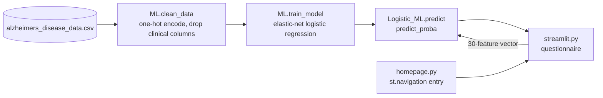

# Alzheimer's Risk Predictor

A Streamlit app that estimates the probability of an Alzheimer's diagnosis from lifestyle, medical history and symptom questions, using a logistic regression model trained on a Kaggle dataset of 2,149 patients.


## Demo

<!-- TODO: demo link or video -->

## Overview

The app asks 23 questions a person can answer without a doctor: age, BMI, sex, education, ethnicity, 0 to 10 ratings for alcohol use, physical activity, diet and sleep, and yes/no questions about family history, conditions like diabetes and hypertension, and symptoms like memory complaints and confusion. It encodes the answers the same way as the training data and shows the model's predicted probability of a positive diagnosis. This is a student ML project, not a medical tool, and the app says so.

## Key features

- A questionnaire built with Streamlit inputs (number fields, select boxes, sliders and radio buttons) in a two-column layout with a custom theme.
- One-hot encoding of sex, education level and ethnicity that matches the training pipeline, so app inputs line up with the model's 30 features.
- A logistic regression model with elastic-net regularisation, trained when you click Calculate.
- A grid search (`tune_model` in `ML.py`) over solver penalty, `C` and `l1_ratio` with 3-fold cross-validation.

## Tech stack

| Area | Tools |
|---|---|
| Model | scikit-learn (`LogisticRegression`, `GridSearchCV`) |
| Data | pandas, NumPy |
| App | Streamlit |
| Data source | [Alzheimer's Disease Dataset](https://www.kaggle.com/dsv/8668279), Rabie El Kharoua, Kaggle (2024) |

## Architecture



`ML.py` holds the data pipeline and model. `streamlit.py` is the questionnaire, and `homepage.py` is the Streamlit entry point.

## Technical highlights

- `clean_data` drops the dataset's clinical measurements: blood pressure, the cholesterol panel, MMSE score, functional assessment and ADL score. A person filling in a web form usually doesn't know these values, so the model only uses inputs people can answer themselves.
- Elastic-net regularisation (`l1_ratio=0.5`, `saga` solver) mixes L1 and L2 penalties. The L1 part can push weak features to zero.
- Categorical columns are mapped to readable labels before `pd.get_dummies`, so the encoded column names (for example `Ethnicity_Asian`) make the feature order easy to check against the app.

## Results

Running `train_model` with its fixed split (80/20, `random_state=16`) on the 2,149 rows gives these test-set numbers (430 patients, 154 with a diagnosis):

| Metric | Value |
|---|---|
| Accuracy | 69.8% |
| Majority-class baseline | 64.2% |
| Precision, diagnosed class | 0.62 |
| Recall, diagnosed class | 0.41 |

The model beats the baseline but misses most positive cases.

## Getting started

Requires Python 3.10 or later.

```sh
pip install -r requirements.txt streamlit
streamlit run homepage.py
```

Run it from the repo root: `ML.py` loads `alzheimers_disease_data.csv` by relative path, and Streamlit reads the theme from `.streamlit/config.toml`. `streamlit` isn't in `requirements.txt` yet, which is why the command installs it separately.

To run the hyperparameter search instead:

```sh
python ML.py
```

## Known limitations

- The model retrains on every Calculate click instead of being cached.
- The result message says "chance of getting Alzheimer's at some point throughout your life". The model predicts the diagnosis label in this dataset, not lifetime risk.
- `flaskserver/` is an earlier prototype. It sends 10 features to a model that now expects 30, so it no longer works.

## Dataset citation

```bibtex
@misc{rabie_el_kharoua_2024,
  title={Alzheimer's Disease Dataset},
  url={https://www.kaggle.com/dsv/8668279},
  DOI={10.34740/KAGGLE/DSV/8668279},
  publisher={Kaggle},
  author={Rabie El Kharoua},
  year={2024}
}
```
