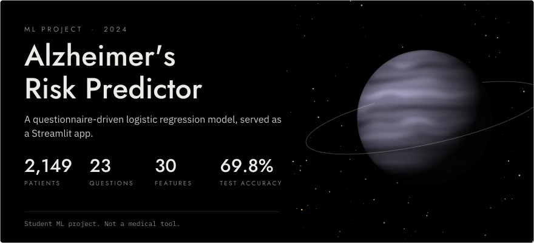
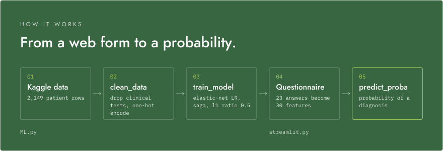
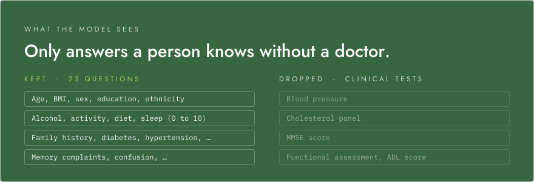
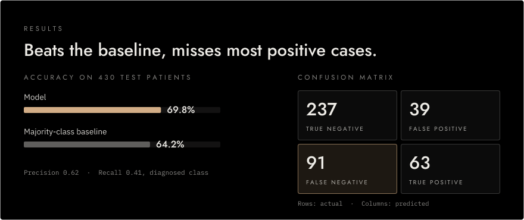

<p align="center">
  <picture>
    <source media="(prefers-color-scheme: dark)" srcset="assets/readme/hero-dark.svg">
    <source media="(prefers-color-scheme: light)" srcset="assets/readme/hero-light.svg">
    
  </picture>
</p>

<p align="center">
  <strong>Estimates the probability of an Alzheimer's diagnosis from 23 questions anyone can answer.</strong><br>
  <strong>69.8% test accuracy &middot; 64.2% majority baseline &middot; 2,149 patients</strong><br>
  <sub>Logistic regression in scikit-learn, served with Streamlit. Data: Kaggle Alzheimer's Disease Dataset (2024). <a href="#results">Details</a>.</sub>
</p>

<p align="center">
  
  
  
  
</p>

<!-- TODO: demo link or video -->

---

The app asks 23 questions a person can answer without a doctor, encodes the answers the same way as the training data, and shows the model's predicted probability of a positive diagnosis. It is a student ML project, not a medical tool, and the app says so.

## How it works

<p align="center">
  <picture>
    <source media="(prefers-color-scheme: dark)" srcset="assets/readme/how-it-works-dark.svg">
    <source media="(prefers-color-scheme: light)" srcset="assets/readme/how-it-works-light.svg">
    
  </picture>
</p>

`ML.py` holds the data pipeline and the model. `clean_data` maps sex, education and ethnicity to readable labels before `pd.get_dummies`, so encoded columns such as `Ethnicity_Asian` are easy to check against the app's feature order. `train_model` fits a logistic regression with elastic-net regularisation (`saga` solver, `l1_ratio=0.5`), which mixes L1 and L2 penalties; the L1 part can push weak features to zero.

`streamlit.py` is the questionnaire: number fields, select boxes, sliders and radio buttons in a two-column layout with a custom theme. It one-hot encodes the answers into the same 30 features, and `homepage.py` is the Streamlit entry point. `tune_model` in `ML.py` runs a grid search over penalty, `C` and `l1_ratio` with 3-fold cross-validation.

## What the model sees

<p align="center">
  <picture>
    <source media="(prefers-color-scheme: dark)" srcset="assets/readme/inputs-dark.svg">
    <source media="(prefers-color-scheme: light)" srcset="assets/readme/inputs-light.svg">
    
  </picture>
</p>

The dataset includes clinical measurements: blood pressure, a cholesterol panel, the MMSE score, a functional assessment and an ADL score. `clean_data` drops them, because a person filling in a web form usually doesn't know these values. What remains is age, BMI, sex, education and ethnicity; 0 to 10 ratings for alcohol use, physical activity, diet and sleep; and yes/no questions about family history, conditions such as diabetes and hypertension, and symptoms such as memory complaints and confusion.

## Results

<p align="center">
  <picture>
    <source media="(prefers-color-scheme: dark)" srcset="assets/readme/results-dark.svg">
    <source media="(prefers-color-scheme: light)" srcset="assets/readme/results-light.svg">
    
  </picture>
</p>

These numbers come from running `train_model` with its fixed split (80/20, `random_state=16`) on all 2,149 rows. The test set has 430 patients, 154 of them with a diagnosis. The model beats always predicting "no diagnosis" by 5.6 points, but it misses 91 of the 154 diagnosed patients, a recall of 0.41.

## Getting started

Requires Python 3.10 or later.

```sh
pip install -r requirements.txt streamlit
streamlit run homepage.py
```

Run it from the repo root: `ML.py` loads `alzheimers_disease_data.csv` by relative path, and Streamlit reads the theme from `.streamlit/config.toml`. `streamlit` isn't in `requirements.txt` yet, which is why the command installs it separately.

To run the hyperparameter search instead:

```sh
python ML.py
```

## Known limitations

- The model retrains on every Calculate click instead of being cached.
- The result message says "chance of getting Alzheimer's at some point throughout your life". The model predicts the diagnosis label in this dataset, not lifetime risk.
- `flaskserver/` is an earlier prototype. It sends 10 features to a model that now expects 30, so it no longer works.

## Dataset citation

```bibtex
@misc{rabie_el_kharoua_2024,
  title={Alzheimer's Disease Dataset},
  url={https://www.kaggle.com/dsv/8668279},
  DOI={10.34740/KAGGLE/DSV/8668279},
  publisher={Kaggle},
  author={Rabie El Kharoua},
  year={2024}
}
```
